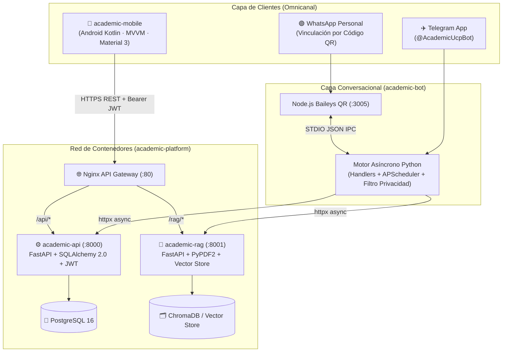

# 🎓 Academic — Ecosistema Universitario Distribuido con IA (RAG), App Android y Bot Omnicanal

> **Plataforma integral de gestión académica e inteligencia artificial** diseñada bajo una arquitectura de microservicios desacoplados. Combina una API RESTful segura (**FastAPI + PostgreSQL + JWT/RBAC**), un motor de **Retrieval-Augmented Generation (RAG)** con citas verificables por página sobre apuntes PDF (**ChromaDB**), un **Bot Omnicanal (WhatsApp QR + Telegram)**, una **App Nativa Android en Kotlin (MVVM + Material Design 3)** y orquestación mediante **Docker Compose + Nginx Gateway**.

---

## 🚀 Enlaces Directos para Portafolio, CV y Reclutadores

- 🖥️ **[Probar Demo Interactiva en el Navegador (GitHub Pages)](https://academi-dev.github.io/academic-platform/)** — Emulador en vivo de la App Android + Bot de WhatsApp/Telegram + Laboratorio RAG + Inspector de tráfico HTTP.
- 📘 **[Leer Documento Técnico de Arquitectura y Sustentación](https://github.com/academi-dev/academic-platform/blob/main/docs/DOCUMENTO_TECNICO_SUSTENTACION.md)** — Diagramas de arquitectura, modelo entidad-relación, flujos de secuencia y decisiones de ingeniería.

---

## 🗂️ Catálogo de los 5 Repositorios del Ecosistema

| # | Repositorio | Rol en la Arquitectura | Stack Principal | Pruebas |
| :-: | :--- | :--- | :--- | :-: |
| **1** | [**`academic-api`**](https://github.com/academi-dev/academic-api) | Backend central, autenticación JWT (`access` + `refresh`), RBAC y CRUD de materias/tareas | Python · FastAPI · SQLAlchemy 2.0 · Alembic · PostgreSQL | `23/23 PASS` |
| **2** | [**`academic-bot`**](https://github.com/academi-dev/academic-bot) | Asistente conversacional omnicanal para **WhatsApp (Código QR)** y **Telegram** con recordatorios | Python · `python-telegram-bot` · Node.js `@whiskeysockets/baileys` · `APScheduler` | `34/34 PASS` |
| **3** | [**`academic-mobile`**](https://github.com/academi-dev/academic-mobile) | Aplicación nativa Android con renovación transparente de sesión y cifrado local AES-256 | Kotlin · MVVM · Material Design 3 · Coroutines · Retrofit 2 + OkHttp 4 | `JUnit4 Suite` |
| **4** | [**`academic-platform`**](https://github.com/academi-dev/academic-platform) | Orquestador de contenedores, Reverse Proxy, lanzador local, simulador web y suite E2E | Docker Compose · Nginx (`1.25-alpine`) · PowerShell · Python `httpx` | `41/41 E2E OK` |
| **5** | [**`academic-rag`**](https://github.com/academi-dev/academic-rag) | Microservicio de IA para ingesta de PDFs, chunking con solapamiento y búsqueda semántica con citas | FastAPI · ChromaDB · `PyPDF2` · `sentence-transformers` | `13/13 PASS` |

---

## 🏗️ Arquitectura General del Sistema

---

## 👨‍💻 Autores e Ingeniería

- **Jean Mena** — [@hilton45](https://github.com/hilton45)
- **Eyfer Mena** — [@eyfer3174-commits](https://github.com/eyfer3174-commits)
